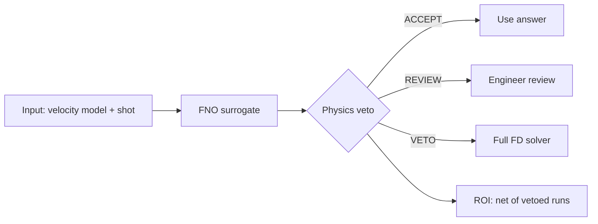

# 🛡️ PhysicsVeto: an AI physics surrogate workbench with a physics veto

**AI surrogates make simulation much faster. Physics decides whether you can trust the answer.**

[](https://github.com/hmoubarak72/PhysicsVeto_2D-acoustic-wave-propagation/actions/workflows/ci.yml)
[](LIVE_DEMO_URL)

PhysicsVeto trains AI surrogates for a physics solver, checks **every prediction** against the governing
equation, the boundary conditions, energy conservation and the training distribution, and routes any
prediction that fails to the full solver. The measured veto rate then drives an honest HPC business case.

> **Case A: 2D acoustic wave propagation** through heterogeneous velocity models, the forward problem behind
> seismic survey design, imaging and full-waveform inversion (FWI). Energy / subsurface vertical.


## Headline results (from `results/`, regenerated by `make bench`)

| Metric | Value |
|---|---|
| FNO error, in-distribution test set (median relative L2) | 2.1% |
| U-Net error, in-distribution (median relative L2) | 2.8% |
| Veto precision / recall, planted-failure benchmark (430 predictions, 222 truly bad) | 83.4% / 99.5% |
| Recall counting VETO + REVIEW | 100.0% |
| Bad answers among accepted predictions (vs. no veto, same stress-test mix) | 0.0% (vs. 51.6%) |
| Veto rate on normal in-distribution work | 0.0% |
| Exact solver output accepted (sanity check) | 100.0% |
| FD solver vs FNO, 64×64, one CPU thread | 13.7 ms vs 15.0 ms per case batched (**0.91×**) |
| Measured speedup at 512×512 (FNO vs FD, one CPU thread) | 3.6× |

"Truly bad" = relative L2 error above 10.0% against the reference solver. Speedups are CPU vs CPU on the same
machine. **At 64×64 the surrogate gives no real speedup (0.91× batched)**; the gap grows with resolution (see the
Benchmark Lab). Production 3D speedups on GPUs are not measured here.

### Per failure mode
| Test set | Type | Cases | Truly bad | Vetoed | Vetoed or review | Bad cases caught |
|---|---|---|---|---|---|---|
| Uniform amplitude drift | model corruption | 40 | 100.0% | 100.0% | 100.0% | 100.0% |
| Injected checkerboard artifact | model corruption | 40 | 0.0% | 100.0% | 100.0% | n/a |
| Extreme velocity contrast | input failure | 40 | 100.0% | 100.0% | 100.0% | 100.0% |
| In-distribution (normal work) | in-distribution | 150 | 0.0% | 0.0% | 0.0% | n/a |
| Mild distribution shift | input failure | 40 | 55.0% | 62.5% | 82.5% | 100.0% |
| Shot moved to edge / deeper | input failure | 40 | 100.0% | 100.0% | 100.0% | 100.0% |
| Rough geology | input failure | 40 | 100.0% | 100.0% | 100.0% | 100.0% |
| Salt body | input failure | 40 | 100.0% | 100.0% | 100.0% | 100.0% |

## Why this matters for CAE / HPC customers
- **Trust is the adoption blocker, not accuracy.** A per-prediction Trust Score with physical evidence lets
  engineers use surrogate answers where they are safe and know when they are not.
- **The veto rate is the business case.** Effective speedup = 1 / (veto rate + 1/speedup). A 10% veto rate
  caps the workflow at 10× no matter how fast the model is, so the ROI model subtracts every vetoed run.
- **It works with any surrogate.** The veto is a layer on top of existing solvers and model frameworks, so it
  fits into the tools customers already own.

## Architecture

Details: [docs/ARCHITECTURE.md](docs/ARCHITECTURE.md).

## Quickstart
```bash
# local (Python 3.11+)
pip install -r requirements.txt && pip install -e .
streamlit run app/Home.py

# rebuild every number from scratch (about 1 hour on a laptop CPU)
make data train bench
make test lint

# optional: LLM drafting in the Go-to-Market Studio (Claude API)
PHYSICSVETO_MOCK=0 ANTHROPIC_API_KEY=... streamlit run app/Home.py

# Docker
docker compose up      # then open http://localhost:8501
```
**Streamlit Community Cloud:** New app → this repo → main file `app/Home.py`. Weights and results are committed,
so the hosted app runs inference only.

The generated datasets (`data/*.npz`, about 630 MB of float32 wavefields) are git-ignored and rebuilt by
`make data` in about a minute with fixed seeds; the committed weights were trained on exactly that data.

## Repository layout
```
app/                 Streamlit: Home.py + 6 pages (Simulate, Physics Veto, ROI, Benchmark Lab, GTM Studio, PRD)
physicsveto/
  solvers/wave.py    2D acoustic FD solver, Mur absorbing edges, CFL check
  data/fields.py     Gaussian-random-field velocity models, planted failure modes, target encoding
  models/            fno.py, unet.py, surrogate.py (normalisation + CPU inference)
  verify/            checks.py (residual, boundary, energy, disagreement), ood.py, trust.py (Trust Score)
  roi/cost.py        HPC cost and time-to-design model, net of vetoed runs, tornado
  gtm/               persona / brief / talk-track templates, optional LLM drafting
  backends/          physicsnemo_backend.py (interface stub, not run)
scripts/             generate_data.py, train.py, benchmark.py, scaling.py, make_report.py, make_figures.py
config/              cases.yaml, veto.yaml, roi_defaults.yaml
results/  weights/   benchmark outputs and pretrained checkpoints (committed)
docs/  tests/        PRD, architecture, model card, case study, demo script; pytest suite
```

## Product thinking
- [PRD and roadmap](docs/PRD.md) · [Case study](docs/CASE_STUDY.md) · [One-page brief](docs/ONE_PAGER.md)
- [5-minute demo script](docs/DEMO_SCRIPT.md) · [Model card](docs/MODEL_CARD.md) · [LinkedIn drafts](docs/LINKEDIN_POSTS.md)

## Scaling on the NVIDIA stack
The same workflow maps onto NVIDIA PhysicsNeMo for 3D models and multi-GPU training, GPU residual kernels, and
3D review of vetoed cases. The adapter is a stub (`physicsveto/backends/physicsnemo_backend.py`, API names checked
against nvidia-physicsnemo 2.2.2) and is **not run** in this repo. See [ARCHITECTURE.md](docs/ARCHITECTURE.md).

## Limitations
2D, 64×64, acoustic, constant density, synthetic data, CPU only. The veto is calibrated on in-distribution
validation data and must be recalibrated for any real workload. Physics checks have blind spots: a nearly
physically consistent but wrong prediction (for example a uniform amplitude error) barely registers on the
residual and is caught here mainly by model disagreement. The energy check is the weakest signal: it
crossed its hard limit on 8 of 430 benchmark predictions. Planted
failures are synthetic and mostly strong; subtle real-world drift will be harder. The GTM Studio's LLM mode is optional and
off by default (`PHYSICSVETO_MOCK=0` plus `ANTHROPIC_API_KEY`); its drafts are labelled and must be reviewed.

## About the author
Dr Hesham Moubarak, geophysicist with about 25 years of operator experience (ExxonMobil, KOC, Devon), now
building verified subsurface AI.

*Independent portfolio project. Not affiliated with or endorsed by NVIDIA or any vendor mentioned.*
